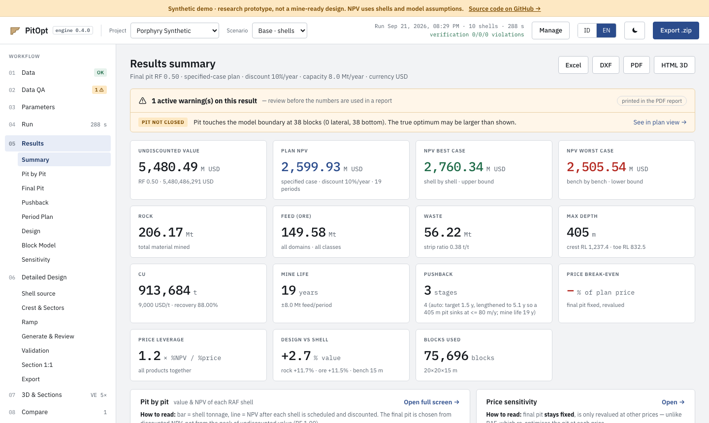
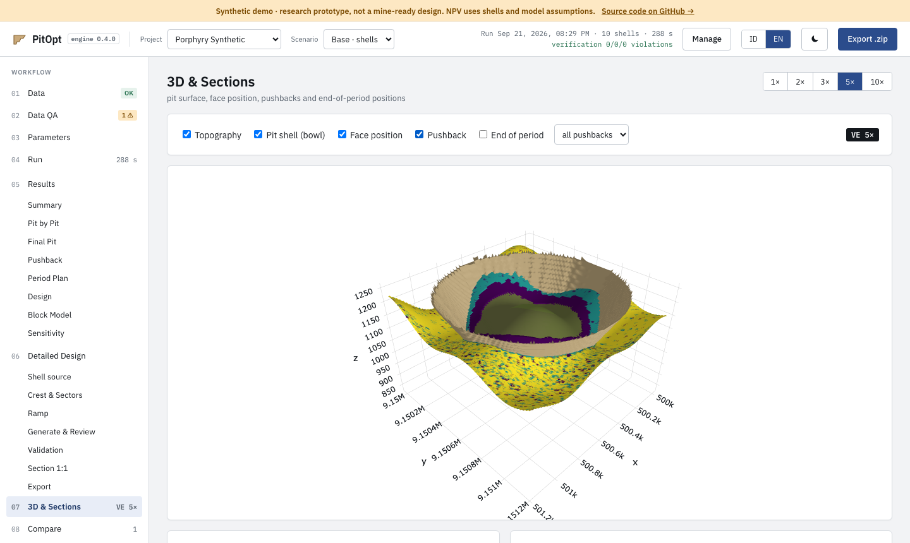

# PitOpt

[](https://github.com/ghoziankarami/pitopt/actions/workflows/ci.yml)
[](LICENSE)
[](https://www.python.org/downloads/)
[](https://pitopt.orebit.id)

PitOpt is open-source software for open-pit mine planning. It reads a block
model (CSV) and a topography surface (DXF or CSV XYZ), then computes nested
revenue-factor shells, a discounted pit-by-pit analysis, the final pit chosen
on NPV, pushbacks, a period-by-period production schedule, and a benched pit
design with ramps. Results export as Excel and PDF reports, DXF surfaces, and an
interactive 3D viewer that works offline. It runs on your own computer; your
data stays on it.



**[Open the live workspace →](https://pitopt.orebit.id/demo)** (synthetic case study, read-only, no sign-up)
&nbsp;·&nbsp; **[Install it locally →](#install)**

## Features

- **Exact ultimate-pit optimisation.** Every shell is a maximum closure solved
  with NetworkX preflow-push and cross-checked against an independent max-flow
  solver and brute force.
- **Strategic workflow.** Nested RF shells, best- and worst-case NPV, final pit
  selection, pushbacks, a capacity-constrained schedule, and price sensitivity.
- **Detailed design.** Benches, berms and ramps per geotechnical sector, checked
  against inter-ramp and overall slope limits and reconciled to the optimised shell.
- **Your data, as delivered.** Map CSV column names from common exports (Surpac,
  Datamine, Vulcan, GEMS, Leapfrog); multi-product and by-product economics;
  `pitopt reblock` regularises sub-celled models.
- **Desktop web app, CLI, and MCP.** A local browser app in English or Indonesian,
  a `pitopt` command for scripting, and an optional MCP server for AI assistants.

<details>
<summary>More screenshots</summary>



</details>

## Install

You need **Python 3.10 or newer** and **Git**. Check with `python3 --version`
(on Windows, `py -3 --version`). Full steps for each platform are in
[docs/INSTALLATION.md](docs/INSTALLATION.md).

**Windows** — in PowerShell or Command Prompt, from the folder where you want PitOpt:

```bat
git clone https://github.com/ghoziankarami/pitopt.git && cd pitopt && PitOpt.bat
```

**macOS** — in Terminal:

```bash
git clone https://github.com/ghoziankarami/pitopt.git && cd pitopt && bash PitOpt.command
```

**Linux** — in a terminal:

```bash
git clone https://github.com/ghoziankarami/pitopt.git && cd pitopt && bash scripts/start_ui.sh
```

The first launch creates a local `.venv`, installs PitOpt, runs the bundled
synthetic examples, and opens <http://127.0.0.1:8765>. The first start takes a
few minutes; later starts take seconds. Keep the launcher window open while you
work and press **Ctrl+C** to stop. Without Git, download the
[ZIP archive](https://github.com/ghoziankarami/pitopt/archive/refs/heads/main.zip),
extract it, and start the launcher for your platform.

## Use it

**With your own data:** in the app, open **Manage → New project**, then upload a
block model (CSV) and, optionally, a topography (DXF or CSV XYZ). The wizard
detects coordinate columns and block size, asks for prices, costs, recoveries
and slopes, and marks every value you did not enter as an assumption.

**From the command line** (after installation, in the `pitopt` folder):

```bash
source .venv/bin/activate        # Windows: .venv\Scripts\activate
pitopt validate --config projects/example_tin/project.yaml   # checks inputs, prints the cutoff grade
pitopt run      --config projects/example_tin/project.yaml   # writes reports to outputs/example_tin/
pitopt ui                                                    # starts the web app
```

Copy `projects/example_tin/` to start your own project; its `project.yaml` is the
fully commented template.

## Documentation

| Document | Contents |
|---|---|
| [INSTALLATION.md](docs/INSTALLATION.md) | Install steps per platform, troubleshooting, optional extras |
| [TECHNICAL.md](docs/TECHNICAL.md) | Outputs, configuration, block valuation, workflow, design, verification, CLI and MCP reference |
| [METODOLOGI.md](docs/METODOLOGI.md) | Calculation rules end to end with a worked example (Indonesian) |
| [RELEASE_AUDIT.md](docs/RELEASE_AUDIT.md) | Release audit and known numerical limitations |
| [PRD.md](docs/PRD.md) | Product requirements for the app |

## Scope and limitations

The closure solve is exact. Everything around it is approximate: the slope
template, flat costs, a single process destination, a schedule that follows a
specified sequence rather than optimising every block, and in-memory graphs that
limit models to the low hundreds of thousands of blocks. An optimum of the
discrete block graph is **not** a mineral resource or reserve estimate, a
geotechnically approved pit, or an optimal production schedule. Design outputs
must be reviewed by a Competent Person under the applicable industry standard
before use. Read [What this is not](docs/TECHNICAL.md#what-this-is-not) before
taking a number into a study.

## Contributing

Bug reports, ideas and pull requests are welcome. See
[CONTRIBUTING.md](CONTRIBUTING.md) and the [Code of Conduct](CODE_OF_CONDUCT.md).
Report security issues privately as described in [SECURITY.md](SECURITY.md).
If PitOpt is useful to you, a ⭐ on GitHub helps others find it.

## License and citation

PitOpt is released under the [MIT License](LICENSE); copies and derivative works must keep the copyright notice, `LICENSE` and [NOTICE](NOTICE). The names "PitOpt" and "Orebit" and the logo are not licensed for forks or competing products; see [TRADEMARKS.md](TRADEMARKS.md). Bundled fonts (OFL-1.1) and
MineLib benchmark files (CC BY-SA 3.0) keep their own licenses; see
[THIRD_PARTY_NOTICES.md](THIRD_PARTY_NOTICES.md). If you use PitOpt in research,
please cite it using [CITATION.cff](CITATION.cff) (GitHub's "Cite this repository" button).
